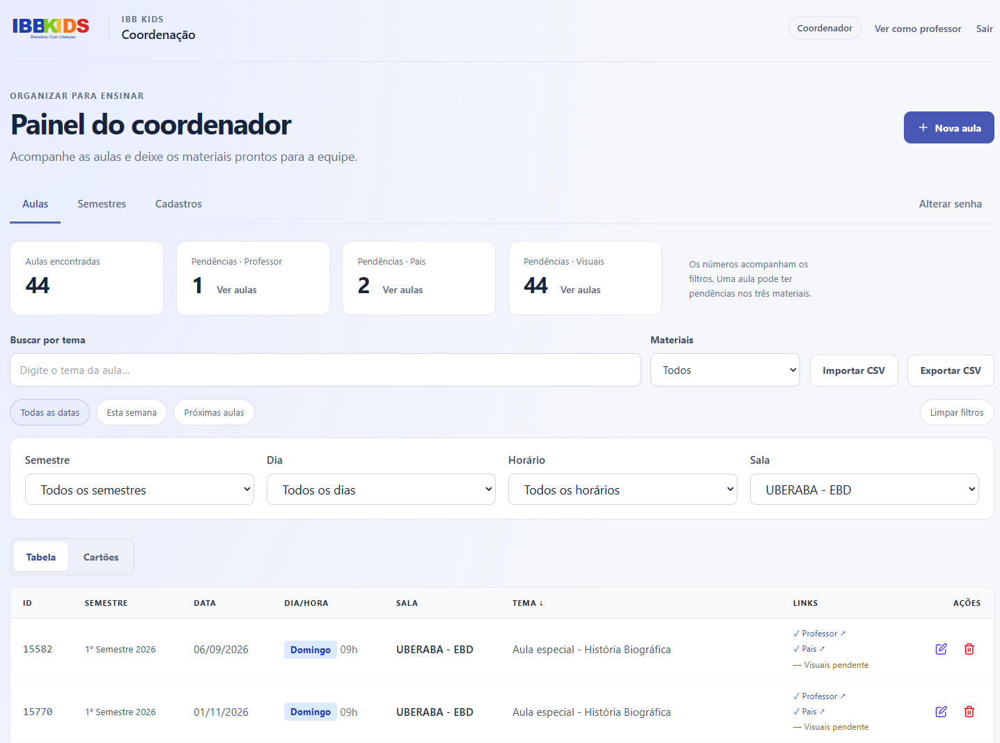

+++
title = "Production Engineering for Single-Node Edge Workloads: Zero-Downtime Releases, WAL Backups, and Native ARM Compilation"
description = "A 10-month operational post-mortem on running a single-instance Node/SQLite workload on Oracle Linux ARM: zero-downtime releases, SQLite WAL backup verification, OCI Instance Principal integration, and native C++ cross-compilation."
date = "2026-10-23"
draft = false
toc = false
categories = ["SRE", "DevOps", "Production Engineering"]
tags = ["SRE", "SQLite", "Node.js", "ARM64", "CI/CD", "OCI", "Linux", "TypeScript"]
author = "Fabio M. Lopes"
image = "ibbkids.jpg"
+++


I originally built IBB Kids as a volunteer project to streamline weekly classroom material management for a non-profit community. Teachers needed instant access to semester schedules, locations, and lesson links without digging through shared spreadsheets.

While the functional requirement was straightforward, the operational constraint was non-negotiable: **the system had to run at zero cost on an ARM-based cloud instance with near-zero maintenance overhead, while remaining reliable enough to be operated by non-technical volunteers.**

Ten months after its initial launch, the core challenge shifted from feature development to **production engineering**: ensuring stateless JWT security, cross-compiling native C++ modules across heterogeneous architectures, executing atomic zero-downtime deployments, and achieving point-in-time database backup integrity without data corruption.

This post documents the architectural decisions, resilience patterns, and operational lessons learned while running a single-node SQLite workload in production up to October 2026.



## Architectural Steering & AI-Augmented Engineering

To maintain high delivery velocity while keeping my primary focus on system reliability, state consistency, and platform security, I adopted an **AI-augmented software engineering workflow**:

* **Architectural Steering & Systems Design (Human):** I designed the system topology, multi-environment isolation model, database state transition rules, JWT session versioning schemes, SQLite WAL backup strategies, native C++ binding validation scripts, and automated CI/CD rollback pipelines.

* **Code Implementation (Codex):** I leveraged OpenAI Codex as an execution engine to translate my technical specifications, API schemas, and architectural constraints into full-stack TypeScript (`React` + `Express` + `SQLite`) code.

* **Validation & Production Hardening (Human):** I established the operational quality gates—including unit/integration testing with isolated in-memory SQLite instances, static security analysis via Semgrep SAST, build-id health checks, and cross-compilation checks for ARM64 Linux runtimes.

This division of responsibilities allowed me to act as a **Tech Lead / Systems Architect**, focusing strictly on system resilience and operability without spending hundreds of hours writing boilerplate application code.

## System Architecture: Single-Node Edge Topology

The application relies on a lightweight, decoupled stack designed to maximize performance on low-spec hardware while enforcing strict domain boundary separation:

* **Frontend:** React with TypeScript, bundled by Vite, styled via Tailwind CSS v4.

* **Backend:** Express API server hosting static production assets.

* **Database:** SQLite running locally via `better-sqlite3`.

* **Process Management:** PM2 enforcing daemon isolation.

* **Edge Proxy:** Nginx managing HTTPS termination via Certbot/Let's Encrypt certificates on Oracle Linux ARM.

```
Browser (React Single-Page App)
    ↓ HTTPS (Port 443)
Nginx (TLS Termination & Reverse Proxy)
    ↓ HTTP Proxy (Internal Loopback)
Express Server (JWT Auth, REST API, Static Asset Delivery)
    ↓ C++ Native Bindings (better-sqlite3)
SQLite Database (WAL Mode: Schedule, Materials, Credentials)
```

In development, Vite proxies `/api` calls to Express. In production, Vite is not running; Express directly serves optimized static assets alongside the API endpoints.

To guarantee environment isolation, **Development** and **Production** co-exist on the same VM but operate with dedicated directories, internal ports, SQLite files, environment secrets, and PM2 instance names.

## Native C++ Bindings & Cross-Compilation Across Environments

Developing on Windows via WSL2 (x86_64) and deploying to Oracle Linux ARM (ARM64) introduced cross-compilation friction—specifically when loading native C++ modules like `better-sqlite3` and `bcrypt`.

A common failure mode in multi-platform deployments is the dreaded `invalid ELF header` error, caused by attempting to execute C++ binaries compiled for x86_64 inside an ARM64 Linux runtime (or sharing `node_modules` across WSL2 and host Windows filesystems).

### Rules for Native Module Isolation

1. **Strict Environment Boundary:** Never share or mount `node_modules` between Windows, WSL2, or remote Linux servers.

2. **Version Pinning:** Enforce Node.js runtime alignment using `.nvmrc` (pinned to Node 22 LTS) and commit explicit lockfiles (`package-lock.json`).

3. **Pre-flight Native Compilation Check:** Introduced a dedicated `npm run prepare-native` lifecycle script during the build step:

```bash
nvm install
nvm use
npm ci
npm run prepare-native
npm test
npm run build
```

The `prepare-native` script attempts to initialize an in-memory SQLite instance and test `bcrypt` hash routines. If native bindings fail to load due to an architecture mismatch, the script automatically invokes `node-gyp` to recompile C++ bindings against local system tools (using `GCC Toolset` and `Python 3.12`) before validating the result.

## SQLite in Production: WAL Mode, Backup Integrity, and OCI Sync

SQLite is a fantastic engine for single-instance workloads, but copying a live `.sqlite` file directly while the process is running is a recipe for database corruption when Write-Ahead Logging (WAL) is enabled. Uncommitted WAL frames will be missed, leading to inconsistent state upon recovery.

```
[ Live Application Writes ]
          ↓
   SQLite DB File + WAL Journal
          ↓
[ SQLite Online Backup API ]  ---> Freezes Consistent Snapshot
          ↓
[ PRAGMA Integrity Checks ]   ---> Validates Headers & Foreign Keys
          ↓
[ Compressed Local Snapshot ]
          ↓
[ OCI Instance Principal ]    ---> Authenticated Direct Stream to Private Object Storage
```

### 1. Online Backup API Execution

Instead of raw file copies, backups utilize the **SQLite Online Backup API** (exposed via `better-sqlite3`). This locks the database safely in read-mode, flushes uncommitted WAL frames, and writes a point-in-time snapshot to a temporary file.

### 2. Automated Integrity Validation

Before any backup is marked valid, the pipeline executes rigorous structural checks:

```sql
PRAGMA integrity_check;
PRAGMA foreign_key_check;
```

If either query returns errors, the snapshot is instantly discarded, and an alert is raised.

### 3. Keyless Cloud Replication via OCI Instance Principals

Once validated locally, daily backup archives are streamed directly to a private **Oracle Cloud Infrastructure (OCI) Object Storage** bucket.

To prevent security credential leaks, the VM relies on **OCI Instance Principals** (IAM dynamic group policies attached to the VM instance). No static private keys, AWS-style secret pairs, or cloud tokens exist in `.env` files or application code.

### 4. Zero-Downtime Restores & State Purging

Restoring a backup automatically triggers:

1. File validation and integrity checks on the candidate snapshot.

2. A compulsory safety backup of the current live database.

3. Graceful application process suspension via PM2 lock files.

4. Database file replacement and global JWT session version invalidation.

5. Application restart and automated `/health` check validation.

## Process Management & Zero-Downtime Releases

Relying on `git pull` and in-place `npm restart` on a production server creates a window of downtime and risks leaving the application broken if native compilation or build steps fail halfway through.

### Why PM2 Fork Mode Trumped Cluster Mode

While PM2 `cluster` mode is popular for horizontal scaling, our workload required single-process `fork` mode for three critical architectural reasons:

1. **SQLite Concurrency & Locking Constraints:** SQLite (`better-sqlite3`) operates as an embedded single-file database. Running multiple worker processes under PM2 `cluster` mode causes multi-process write contention, `SQLITE_BUSY` errors, and potential WAL index corruption.
2. **TypeScript Loader (`tsx`) Hook Resolution:** Executing TypeScript directly via `tsx` requires custom Node.js loader hooks. PM2 cluster mode bypasses standard CLI loaders during `cluster.fork()`, causing socket binding failures.
3. **Deterministic Node.js Runtime Isolation:** Clustered PM2 workers inherit the Node.js version of the running background PM2 daemon. Single-process `fork` mode allows specifying the explicit Node 22 binary path, decoupling application execution from ambient daemon state during runtime upgrades.

### Versioned Release Directories

To achieve zero-downtime releases, deployments use **isolated release directories**:

```
/opt/ibbkids/
├── current -> /opt/ibbkids/releases/20261023_140000/
├── shared/
│   ├── .env
│   └── database.sqlite
└── releases/
    ├── 20261020_091500/
    └── 20261023_140000/  (Active Version)
```

### Deployment Lifecycle Execution

1. **Checkout SHA:** The CI/CD runner fetches the exact commit SHA into a new folder under `/releases/<timestamp>`.

2. **Build & Prepare:** Dependencies are installed (`npm ci`), C++ native bindings are compiled (`npm run prepare-native`), unit tests run against an isolated SQLite instance, and Vite builds static assets.

3. **PM2 Process Spawn:** The application is booted in PM2 `fork` mode using `tsx` and the explicitly configured Node 22 runtime.

4. **Healthcheck Probe Verification:** The deployment script polls the `/health` endpoint. The endpoint returns a unique JSON payload containing the release commit SHA:

```json
{
  "status": "ok",
  "environment": "production",
  "deployId": "sha-8f2a1b9c",
  "dbStatus": "connected"
}
```

5. **Atomic Symlink Switch:** The script accepts the deployment *only* if the `deployId` matches the newly published SHA. Nginx requests are instantly routed to the new code path.

6. **Automated Rollback:** If the health check fails or times out, the deployment script aborts, re-points the symlink to the previous working release folder, restarts the old PM2 process, and preserves the database state.

## Stateful Security & Deterministic Session Invalidation

JWTs are inherently stateless, which presents a security challenge: if an administrative credential is changed, previously issued JWTs remain valid until their natural expiration.

### Session Versioning via `auth_state`

To solve this without adding a heavy Redis layer, I implemented a **database-backed session versioning scheme**:

```sql
CREATE TABLE auth_state (
    profile TEXT PRIMARY KEY,
    session_version INTEGER NOT NULL DEFAULT 1,
    updated_at DATETIME DEFAULT CURRENT_TIMESTAMP
);
```

1. Every issued JWT payload includes the current `sessionVersion` for that profile.

2. Incoming API requests decode the token and cross-check its `sessionVersion` against the `auth_state` table in SQLite.

3. When a user updates their password (or when a database restoration occurs), a single SQLite transaction updates the `bcrypt` password hash and increments `session_version`:

```sql
BEGIN TRANSACTION;
UPDATE credentials SET password_hash = ? WHERE profile = ?;
UPDATE auth_state SET session_version = session_version + 1 WHERE profile = ?;
COMMIT;
```

This instantly invalidates **all active JWT tokens** across all devices for that specific profile in a single atomic database write.

### CI/CD Security Analysis (Semgrep SAST)

The GitHub Actions pipeline includes a dedicated security job running **Semgrep Community Edition (Python 3.12)**:

* Scans pull requests and pushes to `dev`/`develop` branches.

* Enforces rules for hardcoded secrets, SQL injection vectors, and unsafe path interpolations.

* Exports results as SARIF artifacts for historical audit without relying on paid third-party security dashboards.

## Operational Evolution After 10 Months (October 2026 Review)

Returning to the system after 10 months of real-world use provided concrete feedback from the volunteers operating the application:

| Operational Dimension | Initial Design (Dec 2025) | Hardened Architecture (Oct 2026) |
| ----- | ----- | ----- |
| **Material Management** | Teacher and Parent material links | Added **Visual Aids** tracking across database, APIs, and UI layers |
| **Data Granularity** | Single count of incomplete lessons | **Split tracking** for missing Teacher, Parent, and Visual materials |
| **Runtime & PM2 Isolation** | Hybrid Node 20 / Node 22 PM2 daemons | Unified across environments on **Node 22 LTS (ARM64)** using PM2 `fork` mode |
| **Database Purging** | Manual SQL execution | Secure double-confirmation workflow with BCrypt authorization salt and mandatory local WAL snapshot |
| **Backup Redundancy** | Local disk snapshots only | Local integrity-verified snapshots + **OCI Object Storage sync via IAM Instance Principals** |
| **Test & Security Coverage** | Basic build checks | **48 automated unit tests** + **74 Semgrep SAST rules** across 37 JS/TS files |

## Key Takeaways for SREs and Platform Engineers

1. **Single-Node Architectures Can Be Resilient:** You don't always need a multi-node Kubernetes cluster to achieve high availability. When engineered with WAL-aware backups, atomic directory-based releases, and process isolation, single-node systems offer incredible stability at zero cloud cost.

2. **Treat AI as a Force Multiplier, Not a Black Box:** Delegating code generation to tools like Codex works best when the engineer owns the system architecture, boundary constraints, test design, and failure modes.

3. **Align Process Management with Data Constraints:** Single-writer databases like SQLite require single-process (`fork` mode) execution to avoid multi-process file contention (`SQLITE_BUSY`), while ensuring clean TypeScript loader resolution and Node runtime isolation.

4. **Never Trust Raw File Copies on Active Databases:** Always leverage native backup APIs (like SQLite's Online Backup API) to ensure uncommitted WAL frames are safely flushed before snapshotting or shipping data off-site.

## References

* [React Documentation](https://react.dev/)

* [Express Framework](https://expressjs.com/)

* [SQLite Transaction Mechanics](https://sqlite.org/lang_transaction.html)

* [SQLite Online Backup API](https://sqlite.org/backup.html)

* [better-sqlite3 Documentation](https://github.com/WiseLibs/better-sqlite3)

* [OCI Instance Principals Authentication](https://docs.oracle.com/en-us/iaas/Content/Identity/Tasks/callingservicesfrominstances.htm)

* [Semgrep Community Edition](https://semgrep.dev/products/community-edition)
